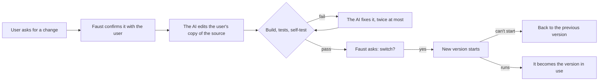

<div align="center">

# Faust

**Repairable apps: your users can fix them themselves.**

Faust is a launcher for Rust apps on macOS. With it, the people who use your app can change it
with any AI model.

*Wer immer strebend sich bemüht, den können wir erlösen.*<br>
<sub>Whoever strives, always, we can redeem. Goethe, Faust II</sub>

[](https://github.com/renshi-a/faust/actions/workflows/ci.yml)
[](#license)


</div>

If an app didn't suit someone, they used to ask its developer and wait. Now anyone can
describe a change in plain words and have an AI write it, and many people already build small
apps for themselves this way. Faust brings that to the apps you ship.

A user asks for a change inside the app. The AI model they chose rewrites the app's source on
their Mac, Faust builds and tests it, and they switch only if it passes and they agree. A
version that can't start is rolled back, your updates are merged with their changes, and users
never need Xcode.

```
┌─ Hello.app ─────────────────────────────────────────────────────────────┐
│  Faust (signed, never rewritten)                                        │
│    installs Rust · keeps the source in git · builds · tests · switches  │
│                                                                         │
│         │ starts          ▲ faust-link: ready / quit / "change this"    │
│         ▼                 │                                             │
│  Hello (built on this Mac from its own source, rewritten on request)    │
└─────────────────────────────────────────────────────────────────────────┘
```

## Contents

- [How it works](#how-it-works)
- [Quick start](#quick-start)
- [What an app adds](#what-an-app-adds)
- [Commands](#commands)
- [What keeps users safe](#what-keeps-users-safe)
- [Requirements](#requirements)
- [Documentation](#documentation)
- [Contributing](#contributing) · [License](#license) · [Acknowledgments](#acknowledgments)

## How it works



1. **You ship source.** `faust package` makes a `.app` holding the launcher and the app's
   source. On first launch, Faust installs Rust into the app's own folder, keeps the source in
   a git repository and builds the first version.
2. **Users ask for changes** through whatever the app offers, such as a menu item or a chat,
   and they can change how they ask, too. Faust shows the request and asks before anything
   happens. The AI may only read, write and search the user's copy of the source.
3. **Every version passes the same checks:** a sandboxed build that stops at any C or Xcode
   tool, the app's tests and its self-test. Then the user decides, and a trial run decides
   again.
4. **Old versions are kept.** Every version and candidate is a commit, and going back is a menu
   item. Your updates are three-way merged with the user's changes. When they conflict, the AI
   resolves it, or makes what the user asked for again on your update, or the user's changes
   are set aside on a branch they can get back.

## Quick start

You need an Apple silicon Mac, [rustup](https://rustup.rs) and an AI model to try changes:
[Claude Code](https://claude.com/claude-code), ChatGPT or Gemini with an API key, or one behind an
OpenAI-compatible API such as [Ollama](https://ollama.com) or [LM Studio](https://lmstudio.ai).

```sh
cargo install --git https://github.com/renshi-a/faust faust-launcher   # the `faust` command
faust new "Happy Day" && cd "Happy Day"                                # a small app to start from
faust dev                           # builds it without Xcode and opens it the way a user would
```

In the window that opens, type into the field at the bottom and ask for something, such as
"make the text larger". To use a model other than Claude Code, click the assistant's name under
the field (or **Another Assistant…** in the confirmation) and choose ChatGPT or Gemini, which
need an API key, or another model by its address (Ollama's is `http://localhost:11434/v1`).

## What an app adds

A repairable app is an ordinary Rust app with three additions.

```
Happy Day/
├── Cargo.toml       depends on faust-link
├── faust.toml       who the app is, and how to build and check it
├── FAUST.md         the rules the AI follows when it changes the app
└── src/main.rs
```

**`faust.toml`**, a few lines ([reference](docs/configuration.md)):

```toml
[app]
name = "Happy Day"
id = "com.example.happyday"

[toolchain]
rust = "1.96.1"

[check]
selftest = ["--selftest"]

[repair]
protect = ["faust.toml", "LICENSE"]
```

**`faust-link`**, a dependency with no dependencies of its own ([docs](crates/faust-link)):

```rust
// Once the first window is on screen:
if let Some(link) = faust_link::get() {
    link.ready();
}

// From the field where the user talks to the app. The assistant answers as the app, and
// suggests a change only when the app can't do what was asked yet:
if let Some(link) = faust_link::get() {
    link.say("make the text larger");
}

// In the event loop:
if let Some(link) = faust_link::get() {
    if link.events().contains(&faust_link::Event::Quit) {
        // save and quit
    }
}
```

Every call is optional: `get()` returns `None` when the app runs on its own, and an app that
never calls `ready()` counts as started after a few seconds. The messages are JSON lines on a
socket, [documented](docs/protocol.md) for apps not written in Rust.

**`FAUST.md`** tells the AI what the app is, what must keep working and what it must not touch.
`faust new` writes a first version, and [Designing repairable apps](docs/repairable-apps.md)
has advice on the rest.

## Commands

| Command | What it does |
|---|---|
| `faust new <folder>` | Creates an app from the template |
| `faust build` | Builds `dist/<name>.app` with `rust-lld` only. Fails if anything reaches for Xcode or a C compiler |
| `faust test` | Runs the app's tests, linked the same way |
| `faust dev` | Packages the working tree and opens it as a user would, with its own state under `target/faust/dev`. Builds first when there is no `Cargo.lock` yet |
| `faust package` | Makes the `.app` users download, from HEAD (`--worktree` for uncommitted changes, `--dmg` for a disk image) |
| `faust release` | Packages HEAD, signs it with your Developer ID, notarizes and staples the app and a `.dmg` |

Faust links with the `rust-lld` that ships with Rust, against a tiny SDK it writes itself, so
only `faust release` uses Xcode (for `notarytool` and `stapler`). If a crate compiles C, the
build stops and shows what was called. A one-line change rebuilds in about a second.

## What keeps users safe

The source can be rewritten, so the rules that protect the user live in the signed launcher,
which the app can't change.

- **The user approves twice:** before the AI starts, with the request in full, and before
  switching, with the changes one click away.
- **The AI gets file tools only.** Claude Code runs in its restricted mode with `Read`, `Edit`,
  `Write`, `Glob` and `Grep`, and no shell, web, MCP servers, hooks or settings files. Other
  models get five tools that Faust carries out itself: list, read, search, write and edit files
  in the repository. Protected files (`[repair] protect`) are put back if touched, and the
  confirmation says where a model's reads are sent.
- **Building is sandboxed.** Build scripts, proc macros, tests and the self-test run under
  `sandbox-exec` and can write only to the version's folder, cargo's output and caches, and
  temporary folders.
- **Bad versions are dropped.** A version that can't show a window within a minute, or exits
  early, is replaced by the previous one.
- **Remote answers must be signed.** A paired device, such as a phone, can answer Faust's
  questions only with an Ed25519 signature over the question it showed, from a key the user
  approved.

[Security model](docs/security.md) covers what this does and doesn't protect against. Please
report vulnerabilities as described in [SECURITY.md](SECURITY.md).

## Requirements

| | Developers | Users |
|---|---|---|
| Mac | Apple silicon, macOS 11 or later | Apple silicon, macOS 11 or later |
| Rust | rustup, with the release `faust.toml` pins | installed by Faust (about 540 MB) |
| Xcode | only for `faust release` (`notarytool`, `stapler`) | not needed |
| AI model | Claude Code, or a model with an OpenAI-compatible API | the same |
| Disk | | about 3 GB free for the toolchain, crates and versions |

## Documentation

| | |
|---|---|
| [Getting started](docs/getting-started.md) | From `faust new` to a released app, with a change and a rollback on the way |
| [Designing repairable apps](docs/repairable-apps.md) | Data that survives going back, tests that mean something, rules the AI can follow |
| [Configuration](docs/configuration.md) | Every key in `faust.toml` |
| [Protocol](docs/protocol.md) | The messages between Faust and the app |
| [Architecture](docs/architecture.md) | The launcher's loop, the repository, the Xcode-free build |
| [Security model](docs/security.md) | Who is trusted with what, and what isn't covered |

## Contributing

Bug reports, ideas and pull requests are welcome. [CONTRIBUTING.md](CONTRIBUTING.md) explains
how to build and test Faust, including the end-to-end test that runs the whole loop without
clicking.

## License

Faust is licensed under either of

- Apache License, Version 2.0 ([LICENSE-APACHE](LICENSE-APACHE))
- MIT license ([LICENSE-MIT](LICENSE-MIT))

at your option. Unless you explicitly state otherwise, any contribution you submit for
inclusion in Faust shall be dual licensed as above, without any additional terms or conditions.

## Acknowledgments

Faust builds on [gitoxide](https://github.com/GitoxideLabs/gitoxide) for git without git,
[objc2](https://github.com/madsmtm/objc2) for AppKit without an SDK, the
[object](https://github.com/gimli-rs/object) crate for reading Mach-O, and the AI models that
do the rewriting, [Claude Code](https://claude.com/claude-code) among them.
