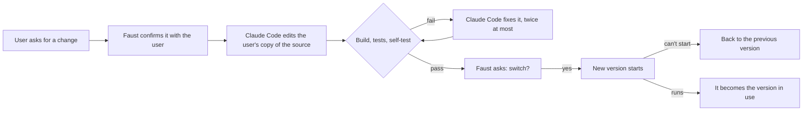

<div align="center">

# Faust

**Ship macOS apps your users can repair.**

*Wer immer strebend sich bemüht, den können wir erlösen.*<br>
<sub>Whoever strives, always, we can redeem. Goethe, Faust II</sub>

[](https://github.com/renshi-a/faust/actions/workflows/ci.yml)
[](#license)


</div>

Faust is a launcher you wrap around a Rust app. You ship the app as source. On the user's
Mac, Faust builds it, starts it, and lets the user change it by asking: Claude Code rewrites
the source, Faust builds and tests the new version, and the user switches to it only if
everything passes and they agree. If the new version can't start, Faust goes back to the
last one that did. When you ship an update, it is merged with the user's own changes.

No Xcode is needed on either side of the counter. Faust links with the `rust-lld` that ships
with Rust, against a tiny SDK it writes itself.

```
┌─ Hello.app ─────────────────────────────────────────────────────────────┐
│  Faust (signed, never rewritten)                                        │
│    installs Rust · keeps the source in git · builds · tests · switches  │
│                                                                         │
│         │ starts          ▲ faust-link: ready / quit / "change this"    │
│         ▼                 │                                             │
│  Hello (built on this Mac from its own source, rewritten on request)    │
└─────────────────────────────────────────────────────────────────────────┘
```

## Contents

- [How it works](#how-it-works)
- [Quick start](#quick-start)
- [What an app adds](#what-an-app-adds)
- [Commands](#commands)
- [What keeps users safe](#what-keeps-users-safe)
- [Requirements](#requirements)
- [Status](#status)
- [Documentation](#documentation)
- [Contributing](#contributing) · [License](#license) · [Acknowledgments](#acknowledgments)

## How it works



1. **You ship source.** `faust package` makes a `.app` holding the launcher and the app's
   source. The first time it opens, Faust installs Rust into the app's own folder, puts the
   source in a git repository and builds the first version.
2. **Users ask for changes.** From the app's menu (or from inside the app, if it can tell what
   the user wants), Faust shows the request and asks before anything happens. Claude Code may
   only read, write and search files in the user's copy of the source.
3. **Every version passes the same gate.** A sandboxed build with tripwires on every C and
   Xcode tool, the app's tests, and its self-test. Then the user decides, and a trial run
   decides again.
4. **Nothing is lost.** Every version and every candidate is a commit. Going back is a menu
   item. Your updates are three-way merged with what the user changed, and when the merge
   conflicts, Claude Code resolves it or the user's changes are set aside on a branch they can
   get back.

The [architecture](docs/architecture.md) document walks through each step.

## Quick start

You need an Apple silicon Mac, [rustup](https://rustup.rs) and, to try changes, [Claude Code](https://claude.com/claude-code).

```sh
cargo install --git https://github.com/renshi-a/faust faust-launcher   # the `faust` command
faust new "Happy Day"               # a small app to start from
cd "Happy Day"
git init && git add -A && git commit -m "Start Happy Day"
faust build                         # dist/Happy Day.app, built without Xcode
faust dev                           # open it the way a user would
```

In the window that opens, choose **Happy Day ▸ Request a Change…** and ask for something:
"make the text larger", "add a button that says hello back". Faust takes it from there.

When you are ready to hand it out:

```sh
faust release                       # signs, notarizes and staples the app and a .dmg
```

The [getting started guide](docs/getting-started.md) goes through the whole loop, including
breaking a version on purpose to watch Faust roll it back.

## What an app adds

A repairable app is an ordinary Rust app with three additions.

```
happy-day/
├── Cargo.toml       depends on faust-link
├── faust.toml       who the app is, and how to build and check it
├── FAUST.md         the rules Claude Code follows when it changes the app
└── src/main.rs
```

**`faust.toml`**, a few lines ([reference](docs/configuration.md)):

```toml
[app]
name = "Happy Day"
id = "com.example.happyday"

[toolchain]
rust = "1.96.1"

[check]
selftest = ["--selftest"]

[repair]
protect = ["faust.toml", "LICENSE"]
```

**`faust-link`**, a dependency with no dependencies of its own ([docs](crates/faust-link)):

```rust
// Once the first window is on screen:
if let Some(link) = faust_link::get() {
    link.ready();
}

// From a "Request a Change…" menu item:
if let Some(link) = faust_link::get() {
    link.request_change(None);
}

// In the event loop:
if let Some(link) = faust_link::get() {
    if link.events().contains(&faust_link::Event::Quit) {
        // save and quit
    }
}
```

Every call is optional: `get()` returns `None` when the app runs on its own, and an app that
never calls `ready()` counts as started once it has kept running for a few seconds. The
messages are plain JSON lines on a socket, [documented](docs/protocol.md) for apps that
aren't written in Rust.

**`FAUST.md`**, the rules for the assistant: what the app is, what must keep working, what it
must not touch. `faust new` writes a first version; [Designing repairable apps](docs/repairable-apps.md)
has advice on what to put in it.

## Commands

| Command | What it does |
|---|---|
| `faust new <folder>` | Creates an app from the template |
| `faust build` | Builds `dist/<name>.app` with `rust-lld` only. Fails if anything reaches for Xcode or a C compiler |
| `faust test` | Runs the app's tests, linked the same way |
| `faust dev` | Packages the working tree and opens it as a user would, with its own state under `target/faust/dev` |
| `faust package` | Makes the `.app` users download, from HEAD (`--worktree` for uncommitted changes, `--dmg` for a disk image) |
| `faust release` | Packages HEAD, signs it with your Developer ID, notarizes and staples the app and a `.dmg` |

`faust build` doubles as a check that an app can be built on a Mac without Xcode: a crate that
compiles C trips a wire, and the build stops and shows what was called. Rebuilds skip the first link stage
while the code uses no new system functions, so a one-line change rebuilds in about a second.

## What keeps users safe

The source can be rewritten, so nothing that protects the user lives in it. The signed
launcher holds those rules, and the app can't change the launcher.

- **The user approves twice.** Before Claude Code starts, with the request in full; and before
  switching, with the changes one click away.
- **The assistant has a small box.** Claude Code runs in its restricted mode with only `Read`,
  `Edit`, `Write`, `Glob` and `Grep`: no shell, no web, no MCP servers, no hooks, and no
  settings files, not even ones a rewritten source could plant. Protected files
  (`[repair] protect`) are put back if it touches them.
- **Building is sandboxed.** Build scripts, proc macros, tests and the self-test run under
  `sandbox-exec`, and may write only to the version's own folder, cargo's output and caches, and
  the temporary folders, never to the repository, the state or the other versions.
- **Bad versions don't stick.** A version that can't show a window within a minute, or exits
  early, is dropped, and the previous one comes back.
- **Remote answers must be signed.** If the app pairs with another device (a phone, say), that
  device can answer Faust's questions only with an Ed25519 signature, over the question it
  showed, from a key the user approved in Faust's own dialog.

[Security model](docs/security.md) covers what this does and doesn't protect against. Please
report vulnerabilities as described in [SECURITY.md](SECURITY.md).

## Requirements

| | Developers | Users |
|---|---|---|
| Mac | Apple silicon, macOS 11 or later | Apple silicon, macOS 11 or later |
| Rust | rustup, with the release `faust.toml` pins | installed by Faust (about 540 MB) |
| Xcode | only for `faust release` (`notarytool`, `stapler`) | not needed |
| Claude Code | to try changes | to ask for changes |
| Disk | | about 3 GB free for the toolchain, crates and versions |

## Status

Faust is young. It was split out of the launcher of VisualClaw, a desk robot app that is
changed this way, so that any app can do the same. Expect the configuration and the protocol
to change before 1.0; both carry versions, so a launcher can keep talking to apps built for an
older one. The crates aren't on crates.io yet: install from this repository, and new apps
depend on `faust-link` by its git tag.

Planned next:

- Downloads besides Rust that an app declares in `faust.toml` (pinned by hash), such as a
  Node runtime.
- More assistants than Claude Code (`codex exec`, `gemini -p`).
- `faust doctor`: checks an app for what keeps it repairable, and explains what doesn't.
- App templates for UI frameworks (GPUI, egui) once they build without Xcode.

## Documentation

| | |
|---|---|
| [Getting started](docs/getting-started.md) | From `faust new` to a released app, with a change and a rollback on the way |
| [Designing repairable apps](docs/repairable-apps.md) | Data that survives going back, tests that mean something, rules the assistant can follow |
| [Configuration](docs/configuration.md) | Every key in `faust.toml` |
| [Protocol](docs/protocol.md) | The messages between Faust and the app |
| [Architecture](docs/architecture.md) | The launcher's loop, the repository, the Xcode-free build |
| [Security model](docs/security.md) | Who is trusted with what, and what isn't covered |

## Contributing

Bug reports, ideas and pull requests are welcome. [CONTRIBUTING.md](CONTRIBUTING.md) explains
how to build and test Faust, including the end-to-end test that runs the whole loop on the
example app without clicking.

## License

Faust is licensed under either of

- Apache License, Version 2.0 ([LICENSE-APACHE](LICENSE-APACHE))
- MIT license ([LICENSE-MIT](LICENSE-MIT))

at your option. Unless you explicitly state otherwise, any contribution you submit for
inclusion in Faust shall be dual licensed as above, without any additional terms or conditions.

## Acknowledgments

Faust stands on [gitoxide](https://github.com/GitoxideLabs/gitoxide) for git without git,
[objc2](https://github.com/madsmtm/objc2) for AppKit without an SDK, the
[object](https://github.com/gimli-rs/object) crate for reading Mach-O, and
[Claude Code](https://claude.com/claude-code), which does the rewriting.
